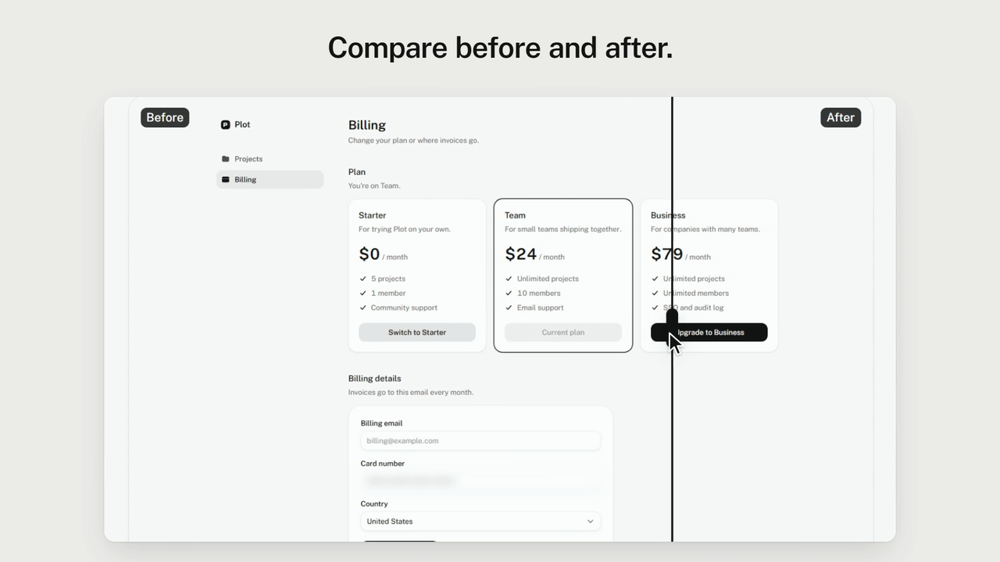
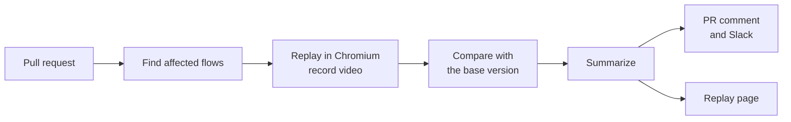

<div align="center">

<picture>
  <source media="(prefers-color-scheme: dark)" srcset="docs/media/mark-dark.svg">
  
</picture>

# Reeldiff

**Every pull request gets a demo of what changed.**

Reeldiff replays your app's key flows on each PR, records a video, compares it with the version before,<br>
and posts a short "what changed" note to the PR and Slack. Reviewers watch the change instead of guessing from a diff.

[](https://github.com/Nuu-maan/reeldiff/actions/workflows/ci.yml)
[](#license)
[](https://nodejs.org)

[Quickstart](#quickstart) · [How it works](#how-it-works) · [Writing flows](docs/flows.md) · [GitHub Action](docs/github-action.md) · [Config](docs/config.md)

<a href="docs/media/launch.mp4">
  
</a>

<sub>▶ <a href="docs/media/launch.mp4">Watch the 22-second tour</a>. Every frame is real Reeldiff output from the example app in this repo.</sub>

</div>

## What you get on every PR

| | |
| --- | --- |
| 🎬 **A video of each affected flow** | Reeldiff clicks through the flow in a real browser and records it, with step markers and captions. |
| ↔️ **Before and after** | Each step is screenshot on both deployments and pixel-diffed. A slider shows exactly what moved. |
| 🖱️ **A clickable demo** | "Try it" rebuilds the page from DOM snapshots, so reviewers can click through without running anything. |
| 📝 **A plain-words summary** | One model call describes the visible change. Without a model key you still get a plain summary. |
| 🔕 **No noise** | Only flows touched by the diff run, and if nothing looks different, nobody gets pinged. |

## How it works



1. **Flows live in your repo.** A flow is a short YAML file: steps like "click New project", plus `covers` globs that link it to the source files it exercises.
2. **Replays are deterministic.** Normal runs use no AI. Playwright clicks through, waits for the page to settle, and records an MP4, screenshots and DOM snapshots.
3. **AI only where it helps.** It drafts new flows (`explore`), fixes steps whose button was renamed (`heal`), and writes the summary. Bring any provider.
4. **The replay page is static files.** HTML, video and images that work offline and from any bucket, linked from the PR comment.


## Quickstart

> [!NOTE]
> The `reeldiff` npm package isn't published yet. Until it is, run it from a clone of this repo (see [Develop](#develop)).

You need Node 22.20+ and ffmpeg. The GitHub Action installs ffmpeg itself on Linux runners.

```sh
npm install --save-dev reeldiff
npx reeldiff init              # config, .reeldiff/flows, a GitHub workflow
npx reeldiff install-browser   # the Chromium build Reeldiff records with
```

Write your first flow, or let a model draft one from a goal:

```sh
npx reeldiff explore "Create a project from a template" --url http://localhost:3000/dashboard
npx reeldiff record create-a-project-from-a-template
npx reeldiff view              # opens the replay page
```

Then add the workflow and secrets to your repo with the [GitHub Action guide](docs/github-action.md). This is the core of it:

```yaml
- uses: Nuu-maan/reeldiff/packages/action@main
  with:
    head-url: ${{ github.event.deployment_status.environment_url }}  # your PR preview
    base-url: https://your-app.com                                    # optional: before and after
  env:
    GITHUB_TOKEN: ${{ secrets.GITHUB_TOKEN }}
    OPENROUTER_API_KEY: ${{ secrets.OPENROUTER_API_KEY }}             # optional: AI summary
```

## A flow looks like this

```yaml
id: create-project
title: Create a new project
start: /dashboard
covers:
  - "src/features/projects/**"   # run this flow when these files change
steps:
  - action: click
    target: { role: button, name: "New project" }
    intent: Open the new project dialog
  - action: fill
    target: { label: "Project name" }
    value: "Acme launch"
  - action: expect
    target: { role: heading, name: "Acme launch" }
```

Targets use the same roles, labels and text a person sees, so flows survive class name and layout changes. See [Writing flows](docs/flows.md) for every action and target.


<sub>Recorded by Reeldiff from <a href="examples/next-app/.reeldiff/flows/create-project.yaml"><code>create-project.yaml</code></a>.</sub>

## Reference

<details>
<summary><b>Commands</b></summary>

| Command | What it does |
| --- | --- |
| `reeldiff init` | Creates `reeldiff.config.ts`, `.reeldiff/flows/`, a GitHub workflow and `.gitignore` entries |
| `reeldiff install-browser [--with-deps]` | Installs the Chromium build Reeldiff uses |
| `reeldiff explore "<goal>" [--url]` | A model drives the browser to the goal, then saves a flow that replays cleanly |
| `reeldiff replay <flowId> [--headed]` | Deterministic replay, exits 1 on the first failing step |
| `reeldiff record <flowId>` | Replays and captures MP4, screenshots and DOM snapshots into `.reeldiff/out/<runId>/` |
| `reeldiff heal <flowId>` | Replays, retargets steps whose element changed, and rewrites the flow file |
| `reeldiff affected --base <ref> --head <ref>` | Lists the flows a git range affects, and why |
| `reeldiff run` | The full CI pipeline: affected, record, compare, summarize, publish, notify |
| `reeldiff view [runId]` | Serves a run's replay page locally |

</details>

<details>
<summary><b>Configuration</b></summary>

`reeldiff init` writes a `reeldiff.config.ts`. A typical one:

```ts
import { defineConfig } from "reeldiff";

export default defineConfig({
  baseUrl: "http://localhost:3000",
  framework: "nextjs-app",           // maps changed files to routes
  uiPaths: ["src/**/*.tsx"],
  model: { provider: "openrouter", model: "anthropic/claude-haiku-5.5" },
  storage: { type: "local", dir: ".reeldiff/published" },  // or S3 / R2
  notify: { slack: { webhookUrl: process.env.SLACK_WEBHOOK_URL }, githubComment: true },
  mask: ["[data-private]"],          // blurred in videos and snapshots
});
```

Every option is in the [config reference](docs/config.md).

</details>

<details>
<summary><b>AI providers and cost</b></summary>

AI is optional and used in three places only: `explore`, `heal` and the run summary. Replays never call a model.

Supported: OpenAI, Anthropic, Google, OpenRouter, Ollama (local) and any OpenAI-compatible endpoint. Keys come from environment variables.

Measured with Claude Haiku through OpenRouter on the example app: a run summary costs about $0.0025, healing a step about $0.0002, and drafting a flow with `explore` about $0.0034. Each run prints its token use and cost.

</details>

<details>
<summary><b>How changes are detected</b></summary>

- **Which flows run:** Reeldiff diffs the PR against its base. A flow runs when a changed file matches its `covers` globs. For Next.js (App and Pages Router), changed route files also get a page snapshot.
- **Did anything change:** with a `base-url`, each step is captured on both deployments. A step counts as changed when the most-changed 64×64 area differs by more than `diffThreshold`. Small edits like a new badge still register.
- **Broken flows:** if a step can't find its target, the flow is reported as broken. With a model key, `heal` suggests a fix in the PR comment. It never edits your branch in CI.

</details>

<details>
<summary><b>Security and privacy</b></summary>

- Model keys and webhook URLs come from environment variables only and are never logged. The action masks every secret it knows about.
- Password inputs and your `mask` selectors are blurred in videos and screenshots and masked in DOM snapshots.
- Record against a preview or staging environment with a test account, never production data.
- No telemetry, no server and no hosted service. Everything runs in your CI and stores files where you choose.

</details>

<details>
<summary><b>Repository layout</b></summary>

| Path | What's there |
| --- | --- |
| [`packages/core`](packages/core) | The engine: flows, replay, recording, diffing, AI, storage, Slack |
| [`packages/cli`](packages/cli) | The `reeldiff` command |
| [`packages/viewer`](packages/viewer) | The static replay page (Vite + React) |
| [`packages/action`](packages/action) | The GitHub Action |
| [`packages/adapters`](packages/adapters) | Route mappers for Next.js |
| [`examples/next-app`](examples/next-app) | Plot, the example app the flows run against |

</details>

## Develop

Requires Node 22.20+, pnpm and ffmpeg.

```sh
pnpm install
pnpm --filter @reeldiff/example-next-app exec playwright install chromium
pnpm build
pnpm test
pnpm --filter @reeldiff/example-next-app dev    # Plot, the example app, on http://localhost:3100
```

From `examples/next-app`, `pnpm exec reeldiff record create-project` records against the running example app. Product spec: [docs/prd.md](docs/prd.md). Progress: [docs/STATUS.md](docs/STATUS.md).

## License

MIT
