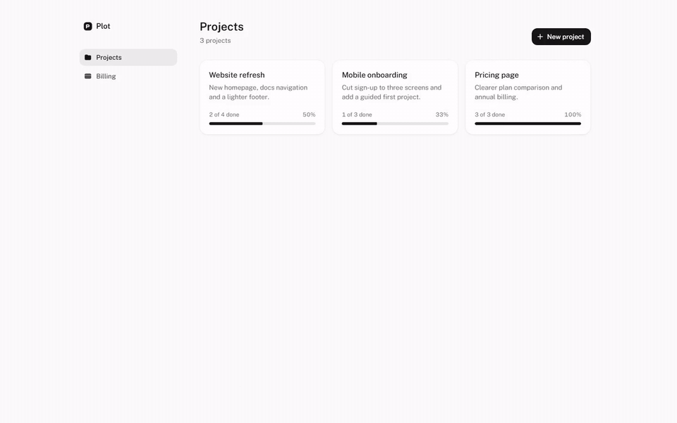
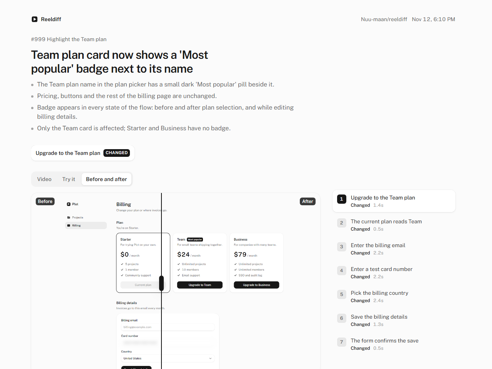

# Reeldiff

Every PR gets a demo of what changed.

Reeldiff keeps a small map of your web app's key flows in the repo. On each pull request it works out which flows the change touches, replays them against the preview deployment, records a video and a clickable demo, and posts a short "what changed" note to Slack and the PR. Open source, bring your own model key.



*Recorded by Reeldiff from [`examples/next-app/.reeldiff/flows/create-project.yaml`](examples/next-app/.reeldiff/flows/create-project.yaml).*

## How it works

1. **Flows live in your repo.** A flow is a YAML file of steps like "click the New project button", each with a stable target and a plain-words intent. `covers` globs link it to the source files it exercises.
2. **Replays are deterministic.** Normal runs use no AI. Reeldiff clicks through with Playwright, waits for the network to settle and records an MP4, screenshots and DOM snapshots.
3. **AI only where it helps.** `explore` writes a new flow from a one-line goal, `heal` fixes a step whose button got renamed, and one summary call per run writes the note. Use any provider: OpenAI, Anthropic, Google, OpenRouter, Ollama or an OpenAI-compatible endpoint.
4. **Only real changes get posted.** With a compare URL, each step is pixel-diffed against the base deployment. If nothing looks different, nobody gets pinged.



The replay page is a static folder (HTML, video, screenshots, snapshots) that works offline and from any bucket. It has a video with step markers, a clickable "Try it" demo rebuilt from DOM snapshots, and a before/after slider.

## Quickstart

Requires Node 22.20+ and ffmpeg (`winget install ffmpeg`, `brew install ffmpeg` or `apt-get install ffmpeg`).

```sh
npm install --save-dev reeldiff
npx reeldiff init                 # config, .reeldiff/flows, a GitHub workflow, .gitignore entries
npx reeldiff install-browser      # the Chromium build Reeldiff records with
```

Write a flow by hand ([flow guide](docs/flows.md)) or let a model draft one:

```sh
npx reeldiff explore "Create a project from a template" --url http://localhost:3000/dashboard
npx reeldiff replay create-a-project-from-a-template
npx reeldiff record create-a-project-from-a-template
npx reeldiff view
```

Then add the workflow to your repo and set secrets ([GitHub Action guide](docs/github-action.md)).

> The `reeldiff` npm package isn't published yet. Until it is, run from a clone of this repo (see [Develop](#develop)).

## Commands

| Command | What it does |
| --- | --- |
| `reeldiff init` | Creates `reeldiff.config.ts`, `.reeldiff/flows/`, a GitHub workflow and `.gitignore` entries |
| `reeldiff install-browser [--with-deps]` | Installs the Chromium build Reeldiff uses |
| `reeldiff explore "<goal>" [--url]` | A model drives the browser to the goal, then saves a flow that replays cleanly |
| `reeldiff replay <flowId> [--headed]` | Deterministic replay, exits 1 on the first failing step |
| `reeldiff record <flowId>` | Replay and capture MP4, screenshots and DOM snapshots into `.reeldiff/out/<runId>/` |
| `reeldiff heal <flowId>` | Replay, retarget steps whose element changed, and rewrite the flow file |
| `reeldiff affected --base <ref> --head <ref>` | Lists the flows a git range affects and why |
| `reeldiff run` | The full CI pipeline: affected, record, compare, summarize, publish, notify |
| `reeldiff view [runId]` | Serves a run's replay page locally |

## Docs

- [Writing flows](docs/flows.md)
- [Config reference](docs/config.md)
- [GitHub Action](docs/github-action.md)
- [Product requirements](docs/prd.md) and [status](docs/STATUS.md)

## Security and privacy

- Model keys and webhook URLs come from environment variables only and are never logged.
- Password inputs and your `mask` selectors are blurred in videos and screenshots and masked in DOM snapshots.
- Use a test account on a preview or staging environment, never production data.
- No telemetry.

## Develop

Requires Node 22.20+, pnpm and ffmpeg.

```sh
pnpm install
pnpm --filter @reeldiff/example-next-app exec playwright install chromium
pnpm build
pnpm test
pnpm --filter @reeldiff/example-next-app dev    # Plot, the example app, on http://localhost:3100
```

From `examples/next-app`, `pnpm exec reeldiff record create-project` records against the running example app.

## License

MIT
